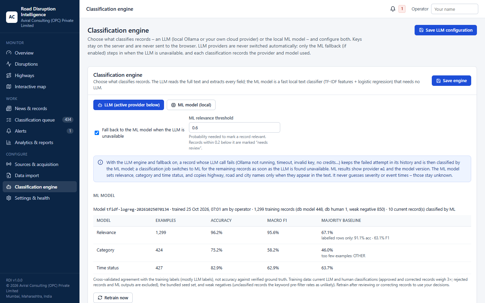
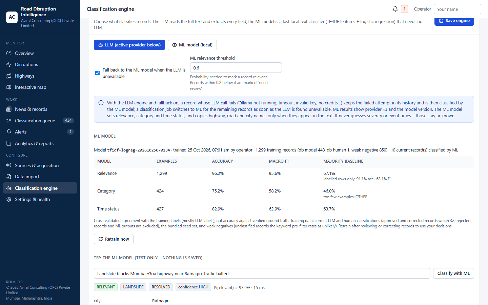
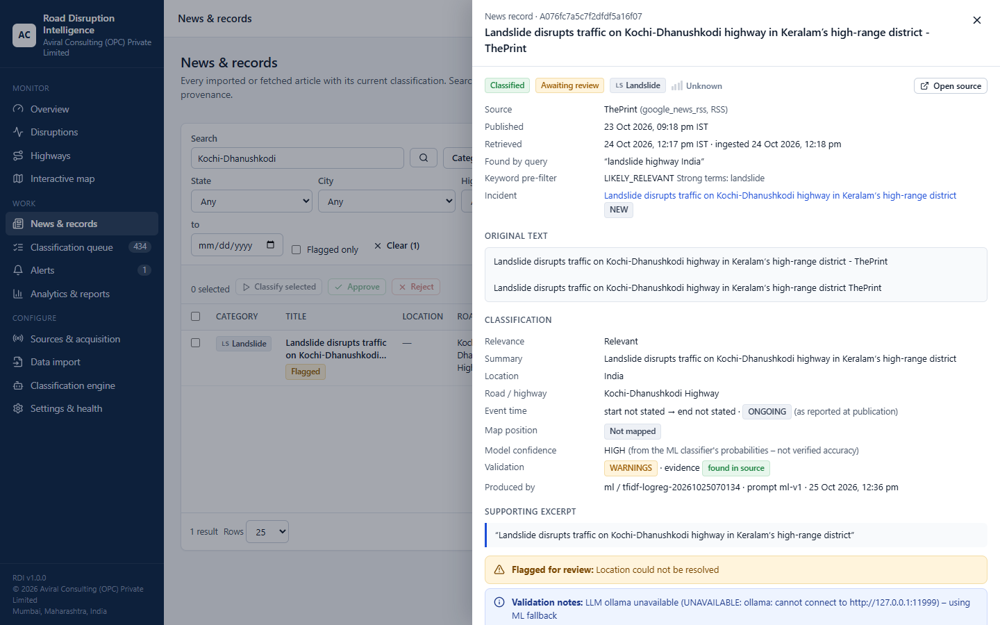
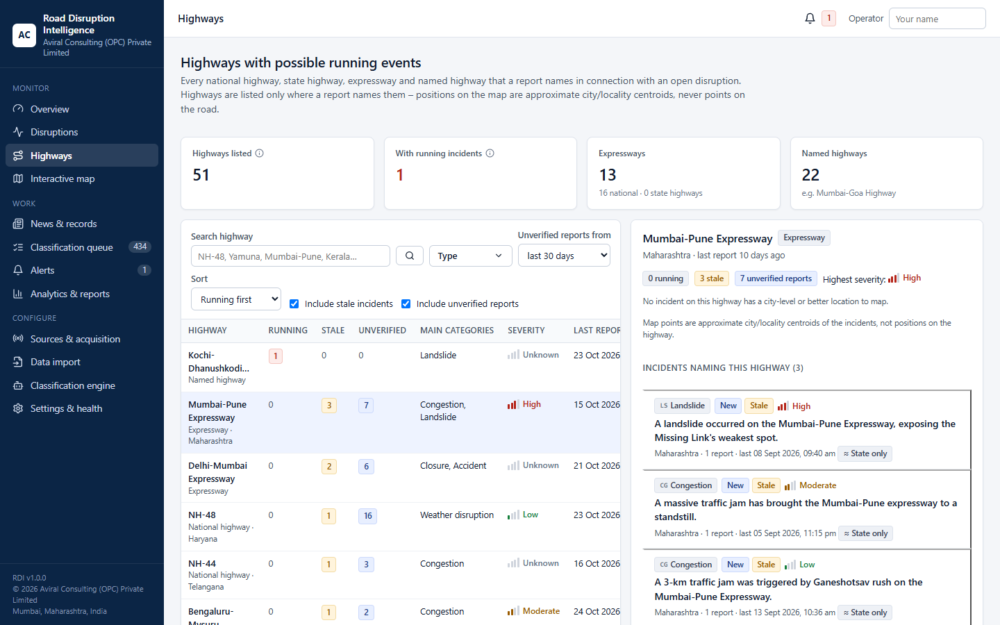
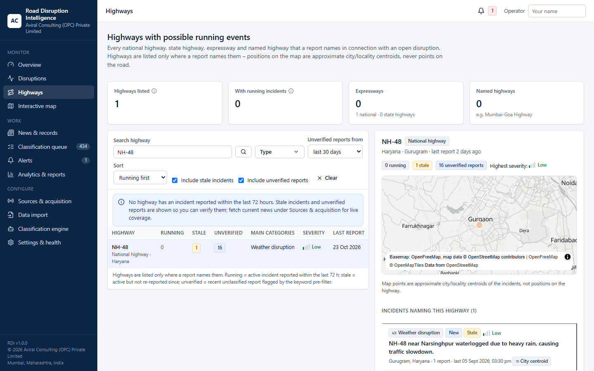
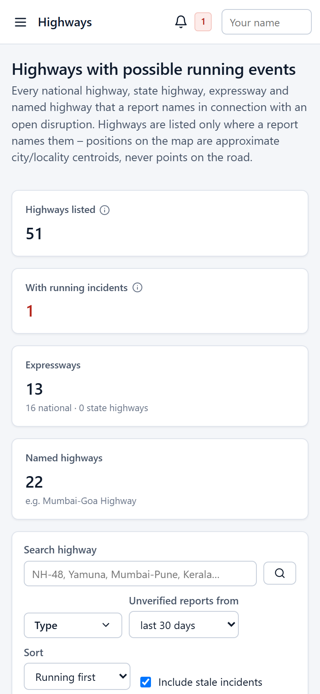

# User guide – Road Disruption Intelligence

A step-by-step guide for operators. No technical knowledge is needed. Screenshots were taken from the running
application with real data on 11 October 2026; the Highways page and ML classifier screenshots were added on
25 October 2026.

**Contents**
1. [Starting and stopping](#1-starting-and-stopping)
2. [The screen layout](#2-the-screen-layout)
3. [Overview dashboard](#3-overview-dashboard)
4. [First-time setup checklist](#4-first-time-setup-checklist)
5. [Importing data](#5-importing-data)
6. [Setting up the classifier (LLM or ML)](#6-setting-up-the-classifier-llm-or-ml)
7. [Getting current news (sources)](#7-getting-current-news-sources)
8. [Classifying records](#8-classifying-records)
9. [Reviewing records (classification queue)](#9-reviewing-records-classification-queue)
10. [Working with a record](#10-working-with-a-record)
11. [Disruptions (incidents)](#11-disruptions-incidents)
12. [Highways](#12-highways)
13. [Interactive map](#13-interactive-map)
14. [Searching and exporting](#14-searching-and-exporting)
15. [Reports and data quality](#15-reports-and-data-quality)
16. [Alerts](#16-alerts)
17. [Settings, API keys, health and backups](#17-settings-api-keys-health-and-backups)
18. [Using it on a phone or tablet](#18-using-it-on-a-phone-or-tablet)
19. [Glossary](#19-glossary)

---

## 1. Starting and stopping

| Action | How |
|---|---|
| First time | Double-click **`setup_and_start.bat`** in the `road-disruption-intel` folder (see the [installation steps](../../README.md#installation)) |
| Every day | Double-click **`start.bat`**. Your browser opens at **http://127.0.0.1:8000/** |
| Open it again later | Just visit http://127.0.0.1:8000/ (or run `start.bat`, which only opens the browser if it is already running) |
| Stop | Double-click **`stop.bat`** |

The application keeps running in a small minimised window called **“RDI Backend”** even if you close the browser.

## 2. The screen layout

* **Left sidebar** – all pages, grouped as *Monitor*, *Work* and *Configure*. Numbers next to *Classification
  queue* and *Alerts* show how many items are waiting.
* **Top bar** – the page title, the alerts bell and the **Operator** box.
* **Operator box (top right)** – type your name once. It is stored in your browser and written into the audit
  trail next to every change you make (approvals, corrections, status changes). It is not a password.

## 3. Overview dashboard

The Overview is the start page. Every number is counted live from the database and refreshes every 30 seconds.
Hover over the ⓘ icon next to a figure to see exactly what it means. **Click any figure** to open the matching list.

| Tile | Meaning |
|---|---|
| Source records | Every row received from files or sources, including repeats of the same article |
| Unique articles | Distinct articles after removing duplicates |
| Relevant reports | Articles the AI classified as real road disruptions |
| Unclassified | Articles not yet analysed by the AI |
| Awaiting review | Classified articles waiting for an operator decision |
| Active incidents | Open incidents with a news report in the last 72 hours |
| High-severity active | Active incidents rated High or Critical |
| Open but stale | Open incidents with **no** recent report – treat as unverified, not as current |
| Resolved (7 days) | Incidents marked resolved in the last week |
| Last live refresh | When a news source was last fetched successfully |

Use the filter bar (dates, state, category) to narrow the charts and counts.

Scroll down for the charts, source health and recent activity:

Click a bar (for example *Diversion* or *Maharashtra*) to open those records.

## 4. First-time setup checklist

The **Getting started** box on the Overview shows five steps. Each tick is set automatically when the step is
really done:

1. Import historical data → section 5
2. Configure and test the LLM, or choose the ML model → section 6
3. Classify records → section 8
4. Fetch current news from a source → section 7
5. Review and approve records → section 9

Press **Hide** when you no longer need it.

## 5. Importing data

Sidebar → **Data import**.

1. The table lists every file found in the `data` folder with its role, number of rows and when it was last
   imported.
2. Tick the files you want and press **Import selected**, or press **Import all data files**.
3. A progress bar appears. You can keep working while it runs.
4. When finished, **Import history** shows the real counts:
   * *Discovered* – rows read; *Imported* – new articles; *Duplicate* – already in the database (nothing is lost);
     *Invalid / Failed* – rejected rows; *Skipped* – not processed (e.g. cancelled).
5. If rows were rejected, press the **Errors** button to download a CSV with the line number and reason for each.

**Upload a file:** choose a `.jsonl`, `.json` or `.csv` file under *Upload a file* and press **Upload & import**.
Each row needs at least a title and a URL (or an id or date).

Importing the same file again is safe – it only adds what is new. Original files are never changed.

## 6. Setting up the classifier (LLM or ML)

Sidebar → **Classification engine**. Two kinds of classifier are available:

| | LLM (large language model) | ML model (built in) |
|---|---|---|
| What it is | Ollama on this computer, or your own OpenAI-compatible / Anthropic key | A small text classifier (TF-IDF + logistic regression) trained on this application's own labelled records |
| What it fills in | Relevance, category, location, road, highway, times, severity, advisory, evidence | Relevance, category and time status; highway, road and city only when written in the text. Severity and event times stay *unknown* |
| Speed | 5–20 s per record (local) | a few milliseconds per record |
| Needs | Ollama + a downloaded model, or an API key | Nothing – works offline |

### Choose the engine

1. At the top, in **Classification engine**, pick **LLM (active provider below)** or **ML model (local)**.
2. Leave **Fall back to the ML model when the LLM is unavailable** ticked (recommended). If Ollama is not running,
   the cloud key is wrong or out of credits, or the request times out, the record is then classified by the ML model
   instead of failing. The failed LLM attempt stays in the record's history, and the record shows the note
   *“LLM … unavailable – classified by the ML fallback”*. A classification job switches to ML for all remaining
   records as soon as it finds the LLM unavailable, so you do not wait for timeouts.
3. **ML relevance threshold** (default 0.6) – how sure the ML model must be before it calls a record *relevant*.
   Records slightly below it are marked *needs review*.
4. Press **Save engine**.

### Option C – the ML model

* The **ML model** box shows the trained model, when it was trained, how many records it learned from and how well
  it agrees with those labels in cross-validation (with the majority-class baseline for comparison). These figures
  measure agreement with the labels it was trained on – mostly earlier LLM classifications – not verified accuracy.
* The model trains itself automatically the first time it is needed (about 10 seconds). Press **Retrain now** after
  you have reviewed or corrected records: approved and corrected records count three times as much, rejected
  records are left out, and the ML model never learns from its own output.
* **Try the ML model** classifies a test headline and shows relevance, category, time status, the probabilities and
  any highway, road or city found in the text. Nothing is saved.
* ML results are labelled everywhere: *Produced by* shows `ml / tfidf-logreg-…` and prompt `ml-v1`.

The LLM options are below the engine box:

### Option A – Local model (Ollama, recommended to start)
1. Under **Local LLM setup (Ollama)** check that Ollama shows *Installed* and *Service running*. If not, run
   `setup_llm.bat` or follow the link to the official installer.
2. The table recommends a model for your computer. Press **Download** next to it and confirm (several GB; needs
   internet). Already-installed models show *Installed*.

3. In **Local Ollama**, type the model name (e.g. `llama3:8b`), press **Save LLM configuration**, then **Test
   connection**. A green *Connected* message means it works.

### Option B – Your own cloud key (OpenAI-compatible or Anthropic)
1. In the provider card, set the API base URL and model name.
2. Paste your key into the key box and press **Save key**. The key is stored on this computer only and is never
   shown again.
3. Choose this provider under **Active provider**, press **Save LLM configuration**, then **Test connection**.
   Cloud usage is billed by the provider.

### Try it
At the bottom, **Test classification** sends a clearly-labelled test headline to the active LLM and shows the
structured result and any validation notes. Nothing is saved.

> One LLM provider is never silently replaced by another. The only automatic step is the ML fallback described
> above, and only if it is ticked. You can always retry a record with any provider – or the ML model – from the
> record panel (section 10).

## 7. Getting current news (sources)

Sidebar → **Sources & acquisition**.

Each card shows:
* **Configuration** – *Configured* or *NOT CONFIGURED* (missing key or feed URL).
* **Verification** – *VERIFIED* only after a real successful fetch on this computer; *FAILING* or *UNVERIFIED* otherwise.
* Last success/attempt, next scheduled run, totals, and the last error in plain language.

Buttons:
* **Fetch now** – fetch immediately (runs in the background; progress is shown).
* **Connection test** – fetch up to 3 sample items without saving them.
* **Settings & history** – change search terms, places, polling interval (minimum 30 minutes), limits, timeouts and
  retries, and see past runs.
* **Scheduled polling** (top-right tick box) – turn automatic fetching on or off for that source.

Google News works without a key. NewsAPI, GNews and Reddit need keys (section 17). Official/custom RSS feeds need
you to paste feed URLs in *Settings & history*.

## 8. Classifying records

Classification means the classifier chosen in section 6 – the LLM or the ML model – reads an article and records
relevance, category, location, road, time, severity and supporting evidence (the ML model fills in fewer fields).

Sidebar → **News & records**.

* **Some records:** tick them and press **Classify selected**.
* **Many records:** set filters first (for example *Pre-filter: Likely relevant*, *Classification: Unclassified*,
  a date range), enter a maximum in **Classify all matching (max …)** and press **Start**. Confirm the dialog.
* A progress bar shows how many are done. You can cancel at any time.
* Records already classified with the same model and prompt are skipped automatically.

Tip: start with recent records that the keyword *pre-filter* marks as **Likely relevant**. A local LLM needs
roughly 10–20 seconds per record; the ML model classifies thousands of records in a few seconds. The job message
tells you if it had to use the ML fallback because the LLM was unavailable.

The setting **Automatically classify newly fetched records** (section 17) classifies new news as it arrives.

## 9. Reviewing records (classification queue)

Sidebar → **Classification queue** shows classified records awaiting an operator decision.

1. Tick **Flagged only** to see records the system thinks need attention first (low confidence, evidence not
   found in the article, unknown location, date problems, old “ongoing” reports).
2. Click a row to open it (section 10), read the original headline and evidence, then decide.
3. For several obvious records at once, tick them and use **Approve** or **Reject** in the action bar
   (rejection asks for confirmation).

What the decisions do:
* **Approve** – confirms the record. Its incident becomes **Confirmed** and is marked as verified by you.
* **Reject** – keeps the record for the audit trail but removes it from incident evidence. An incident left with
  no evidence is dismissed.
* You can change a decision later.

## 10. Working with a record

Click any row in *News & records* or the *Classification queue*.

The panel shows, from top to bottom:
* Status badges, category and severity, and **Open source** (the original article).
* Where it came from: source, publish and retrieval times, the search query that found it, and its linked incident.
* **Original text** – exactly what the source provided (often only the headline).
* **Classification** – relevance, summary, location, road, event time, map position (always marked as
  approximate unless placed by a person), the model’s own confidence, validation result and which model produced it.
* **Supporting excerpt** – the sentence the model relied on, and whether it was found in the article.

Scroll down for actions and history:

* **Review note** + **Approve** / **Reject**.
* **Edit fields** – correct anything (category, city, road, times, severity…). Saving creates a new *human*
  version; the model’s output stays in the history. Enter latitude/longitude to place it exactly on the map.
* **Reclassify** – run the classifier again. The list next to it chooses *Configured engine*, a specific LLM
  provider, or **ML model (local, no LLM)** – useful when the LLM is down or to compare results.
  Records classified by the ML fallback show the reason under *Validation notes*:

  
* **Classification history** – every attempt, including failures, with **Raw output** for checking.
* **Provenance** – every file/query/fetch in which this article appeared.
* **Audit trail** – who changed what and when.

## 11. Disruptions (incidents)

An incident groups reports about the same real-world event. Sidebar → **Disruptions**.

* Use **All / Active / Open but stale / All open / Resolved** at the top, plus search and filters.
* A **Stale** badge means no new report recently – do not treat it as a current closure without checking.
* A **Conflict** badge means sources disagree (e.g. on severity or timing).

Click an incident to open it:

* **Status buttons** move it through *New → Monitoring → Confirmed → Resolved* (or *Dismissed*). Add a note – it is
  saved in the history. Dismissing and resolving ask for confirmation and can be reversed.
* **Linked articles** – evidence with excerpts and source links. **Detach** removes a wrongly-linked article (the
  article is kept).
* **Merge into another incident** – if two incidents are the same event, enter the other incident’s id
  (`INC_…`) and confirm. Articles are moved; nothing is deleted.
* **History** – every status change with who and when.

## 12. Highways

Sidebar → **Highways**. A list of every national highway, state highway, expressway and named highway (for example
*Mumbai-Goa Highway*) that a report names in connection with an open disruption.

* **Running** – open incidents on that highway with a report inside the staleness window (default 72 h). These are
  the ones to act on.
* **Stale** – open incidents without a recent report. Check before treating them as current.
* **Unverified** – recent news that names the highway and that the keyword pre-filter flags, but that has not been
  classified yet. Open one to classify or review it; if it is relevant it joins an incident.
* **Search** by number or name – `NH-48`, `NH 44`, `Yamuna`, `Mumbai-Pune` – or by state or city. Spelling variants
  are combined: *Pune-Mumbai* and *Mumbai-Pune Expressway* are one entry, *Gurgaon* is shown as *Gurugram*.
* **Filters:** highway *Type*, how far back to look for **unverified reports** (24 hours to 1 year), *Include
  stale incidents*, *Include unverified reports*, and the sort order (*Running first*, *Severity*, *Latest report*,
  *Name*).

Click a highway to see its details on the right:

* Counts, the highest reported severity and the states and cities involved.
* A small map of the incidents. Points are approximate city or locality centres, not positions on the road.
* **Incidents naming this highway** – click one to open the full incident (section 11).
* **Unverified recent reports** – click one to open the record panel (section 10), or follow the source link.

> A highway appears only when a report names it (for example *NH-48* or *Mumbai-Pune Expressway*). Reports that
> describe a road without naming it are not assigned to a highway, so an empty list does not prove a highway is clear.

## 13. Interactive map

Sidebar → **Interactive map**.

* **Left panel:** the same filters as *Disruptions* (lifecycle, category, severity, status, city, state, highway,
  source, review state), quick time buttons (**7 d / 30 d / 90 d / All**) or exact dates. The list underneath always
  matches what the map shows. It also tells you how many incidents have **no usable location** (they are listed but
  not drawn).
* **Markers:** colour = severity (light = low, dark = critical, grey = unknown); letters = category (e.g. *AC*
  accident, *CL* closure, *DV* diversion, *FL* flooding); dark outline = confirmed; faded = stale; a soft halo = the
  position is only a city centre. Numbers in dark circles are clusters – click to zoom in.
* **Toolbar:** **Fit to results** zooms to all shown incidents; **Reset view** returns to India; **Focus region**
  jumps to Mumbai, Delhi NCR, Pune, etc.
* **Legend** (bottom left) explains the symbols; click it to collapse.

Click a marker or a list item to open the incident panel with evidence and source links:

Press **Open full details** to manage the incident (section 11).

> Positions are approximate (city or locality centres). The map does not show exact closure points or routed road
> segments. The background map needs internet; without it the list still works.

## 14. Searching and exporting

In **News & records**:
* **Search** finds words in titles, summaries, places, roads and sources. Highway searches like `NH 48` or `NH-48`
  also work.
* Combine **Category, Severity, Relevance, Classification, Review, Pre-filter, State, City, Highway, Source,
  dates** and **Flagged only**. The active filter count is shown on **Clear**.
* Click a column heading to sort; use the arrows at the bottom to page through results.
* The page address contains your filters – bookmark it or send it to a colleague on the same computer.

**Export:** press **Export CSV** or **Export JSON** (top right). The file contains exactly the filtered records
(up to 50,000), with a note of when it was generated and which filters were used. *Disruptions* has the same
**CSV / JSON** buttons for incidents. CSV files open directly in Excel.

## 15. Reports and data quality

Sidebar → **Analytics & reports**.

**Summary report** – choose a date range (and optionally a state) and press **Generate**:

Press **Print / save as PDF** and choose *Save as PDF* in the print dialog to share it.

**Data quality** tab – missing fields, location precision, conflicting and stale incidents, failed
classifications (with a link to retry them), possible duplicate incidents, and source reliability measured from
your own review decisions:

## 16. Alerts

When an incident matching the alert rule (by default: severity **High** or above becoming **Confirmed**) occurs, an
alert appears. The bell in the top bar and the sidebar show the unread count.

Click the message to open the incident; use **Mark read** or **Mark all read**. Each incident raises at most one
alert per rule. Alerts are in-app only (no e-mail/SMS).

## 17. Settings, API keys, health and backups

Sidebar → **Settings & health**.

* **Branding & workflow** – company and product name, optional logo URL; classification rules (auto-classify, what
  gets flagged); incident rules (stale after N hours, linking window, auto-resolve); alert rules; map style.
  Press **Save** on each card.
* **API keys** – enter or remove keys for news sources and AI providers. Keys are stored only on this computer and
  are never shown again.
* **Health & backups** – system checks, where data is stored, what needs internet, and **Back up now**:

* **Audit trail** – every recorded change, newest first.

Restoring a backup is described in [SETUP_GUIDE.md](../SETUP_GUIDE.md#10-backups-and-restore).

## 18. Using it on a phone or tablet

The interface adapts to small screens. Use the ☰ button (top left) to open the menu. On the map page, tap
**Filters** to show or hide the filters.

| Overview | Map | Highways |
|---|---|---|
|  |  |  |

By default the application only accepts connections from the computer it runs on. To use it from other devices on
your office network, see [SETUP_GUIDE.md §9](../SETUP_GUIDE.md#9-using-it-from-other-computers-optional).

## 19. Glossary

| Term | Meaning |
|---|---|
| Record / article | One news item from a file or source |
| Pre-filter | A quick keyword check used only to decide what to classify first – not an AI decision |
| Classification | The classifier’s structured reading of a record (relevance, category, location, time, severity, evidence) |
| Classification engine | Which classifier is used: the LLM or the built-in ML model |
| ML model | Built-in text classifier (TF-IDF + logistic regression) trained on this application’s labelled records |
| ML fallback | Automatic use of the ML model for a record when the LLM cannot be reached |
| Relevant / Related / Irrelevant | A real road disruption / general transport news / not about roads in India |
| Incident | A group of records about the same event |
| Active | Open incident with a recent report (default 72 h) |
| Stale | Open incident with no recent report – not verified as current |
| Approximate location | City or locality centre, not the exact spot |
| Model confidence | The LLM’s own judgement, or for the ML model a value derived from its probabilities (Low/Medium/High) – neither is verified accuracy |
| Running (highway) | Open incident on a named highway with a report inside the staleness window |
| Unverified report | Recent, not yet classified news that names a highway and passes the keyword pre-filter |
| Provenance | Where and when a record was seen |
| Audit trail | Log of who changed what and when |
